# Does switching between 3D and 2D diffusion speed up receptor finding?

**The D = 0.5 matrix, October 2026.** 3D HCP lattice, 87 paired runs (plus 2 pilots), 69 600 molecule trajectories.
Decision-log entries L91–L96; figures regenerated by `bash scripts/make_figures.sh`.

## The design, in one paragraph

Two walkers search the same receptor layouts for the same target cells. The
**switching** walker alternates between free diffusion in the interstitial gaps and
bound diffusion on a cell membrane. The **non-switching** reference never binds: it
diffuses freely for the whole run. Both use **D = 0.5 µm²/s in every state** (L91), so
binding changes *where* the walker is but never *how fast* it moves. Any difference
between the two is therefore geometric — it cannot be a mobility effect.

The readout is **t_20: the time by which 20% of all molecules have been captured.**
Molecules that escape the cluster, or that are still searching at `t_max`, count as
never captured. So t_20 is a joint statement about speed *and* yield, and it is
**undefined wherever fewer than 20% are ever captured** — those cells are blank, with
the capture fraction printed instead.

Each point is 400 molecules per arm over 20 receptor layouts shared between the two
walkers; error bars are bootstrap 95% CIs over layouts. Default conditions unless the
figure says otherwise: ring 2, 1000 receptors/cell, 1 s mean bound dwell, 5% of time
free, one find to capture, `t_max` = 20 000 s.

## Headline

**Switching wins nearly everywhere, and it wins by not losing molecules.** Because D is
equal in both states, none of the advantage is faster transport. The bound state acts
as a retention mechanism: a walker on a membrane cannot wander out of the cluster, and
it stays in the neighbourhood of the cells it must search. The free-only reference is
faster per unit of distance covered but keeps throwing molecules away.

Three numbers make the point. At ring 2 with 1000 receptors, the free-only walker ever
captures **75.8%** of molecules; the switching walker at 5% free captures **100%**. Going
from 50% free to 100% free — the only change being that the bound state disappears —
raises t_20 from **84 s to 297 s**. And requiring five receptor encounters instead of
one costs the switching walker **2%** (211 → 216 s) while costing the reference **9.7×**
(297 → 2869 s).

## What t_20 is reading off

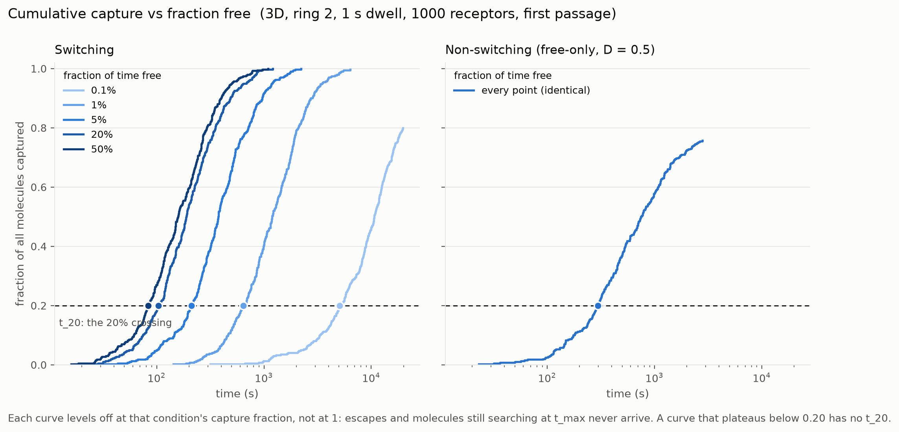

Every t_20 in this report is one point on a curve like these: the fraction of **all**
molecules captured by time t, and t_20 is where it crosses 0.20 (the dots). Two things are
worth seeing directly rather than taking on trust.

First, the curves level off at each condition's capture fraction, **not at 1**. Molecules that
escape the cluster never arrive, so a curve that plateaus below 0.20 has no t_20 at all —
that is what the blank cells in the grids mean. Second, the curves within a panel are close to
a single rising front shifted along the time axis, which is what makes one crossing time a
fair summary of the whole distribution.

There is a matching `capture_*.png` for each cline, drawn from the same runs as the
corresponding `line_*.png`: `capture_free_fraction`, `capture_dwell`, `capture_efficiency`,
`capture_distance`, `capture_distance_N5`, `capture_density`, `capture_density_N5`. The
efficiency one is the clearest single picture in the set — the four switching curves lie
almost on top of each other while the free-only curves fan out and the N = 10 curve never
reaches 0.20.

A detail that falls out of these: along the dwell cline the free-only reference is one run
repeated, and its last capture is at 2789 s. Raising `t_max` from 20 000 s to 100 000 s for
the long-dwell points changed it not at all, so the reference's 76% ceiling at ring 2 is set
by **escapes, not by the time limit**.

## Two-dimensional sweeps

### Fraction free × distance

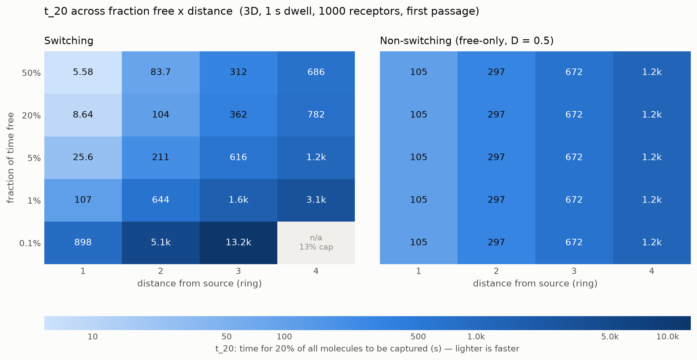

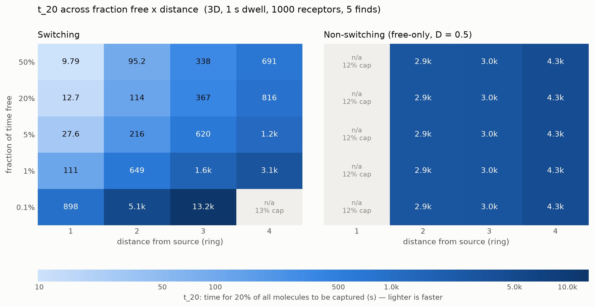

Switching t_20 falls monotonically with free fraction at every distance — more free
time is always better for the switching walker, right up to 50%. The crossover against
the free-only reference sits between **1% and 5% free** at every ring, drifting slightly
outward with distance (at ring 1 the 1% cell is already a tie, 107 vs 105 s; at rings 3
and 4 the 1% cell loses by 2.4× and 2.5×).

The right-hand panel is constant down each column by construction: the reference never
binds, so free fraction means nothing to it. That makes it a clean visual control.

At five finds (second figure) the switching panel is **almost unchanged** — 216, 620 and
1153 s at rings 2, 3, 4 against 211, 616 and 1151 s at one find — while the reference
degrades by 3.5–9.7× and goes undefined at ring 1 (12.5% ever captured). Once bound, a
walker re-encounters the same cell's receptors cheaply; the free walker has to re-find
the cell from the bulk each time.

### Fraction free × receptor density

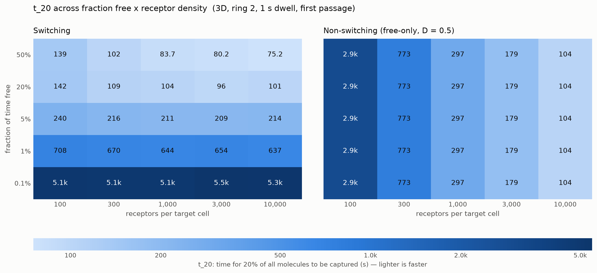

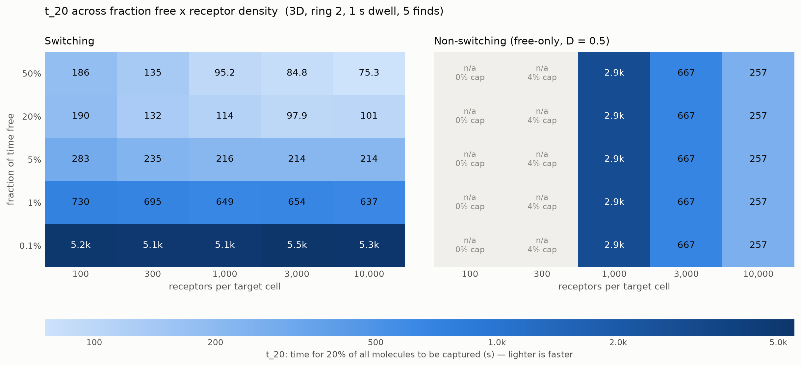

The switching walker is **nearly density-independent**: across a hundredfold range of
receptor density at 5% free, t_20 moves only from 240 to 214 s. Its rate limit is
getting to the target cell, not finding a receptor once there. The reference is the
opposite, spanning 2935 → 104 s over the same range, because for a free walker every
receptor encounter is a fresh search of the whole domain.

The two curves therefore cross. At one find the reference overtakes switching between
**1000 and 3000 receptors** per cell; at five finds switching is still ahead at 10 000
receptors (214 vs 257 s), so the crossover is pushed past the top of the range.

## One-dimensional lines

### Fraction of time free

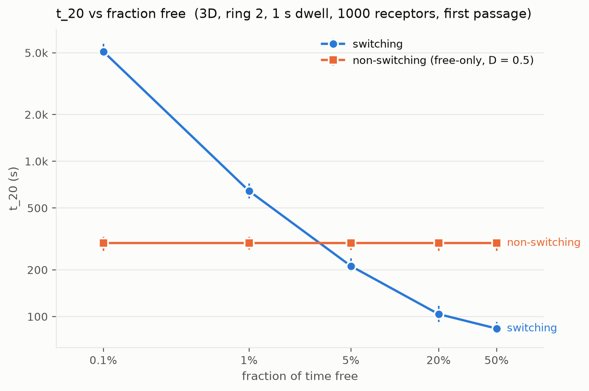

The 5%-free default sits just past the crossover. Note that the rightmost sensible
comparison — 100% free — *is* the reference line, and switching at 50% free beats it
3.6-fold.

### Bound dwell time

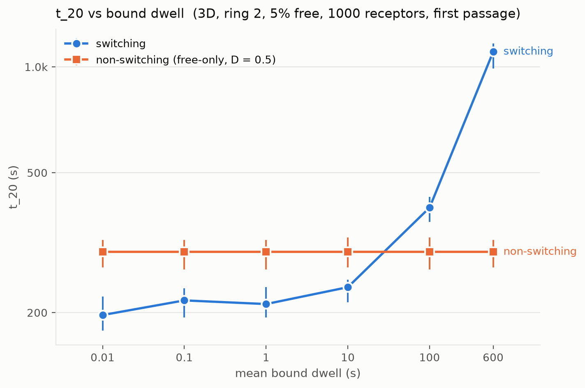

At a fixed 5% duty cycle, dwell sets the absolute timescale of the alternation. t_20 is
flat from 10 ms to 10 s (197 → 236 s) and then degrades sharply: 398 s at 100 s dwell
and 1104 s at 600 s. **Switching stops paying off between 10 s and 100 s of dwell.** Once
a bound excursion lasts longer than the time it would take to diffuse to the target,
the membrane stops being a staging area and becomes a trap.

### Capture efficiency

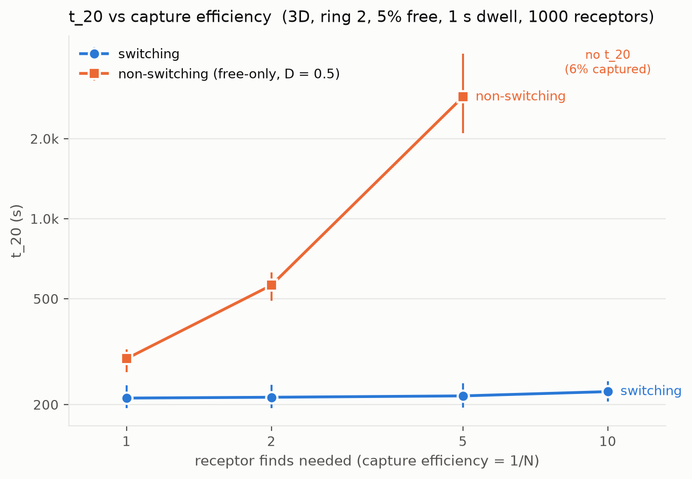

The sharpest result in the set. Requiring 1, 2, 5 or 10 encounters moves switching from
211 to 224 s — **6% across a tenfold change** — while the reference goes 297 → 562 →
2869 s and then has no t_20 at all (5.5% ever captured at N = 10). Low capture
efficiency is exactly the regime where reduction of dimensionality should matter most,
and it is.

### Distance from source

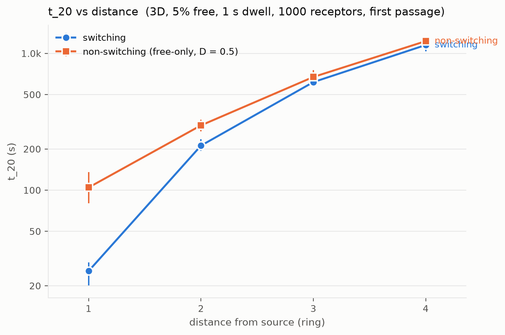

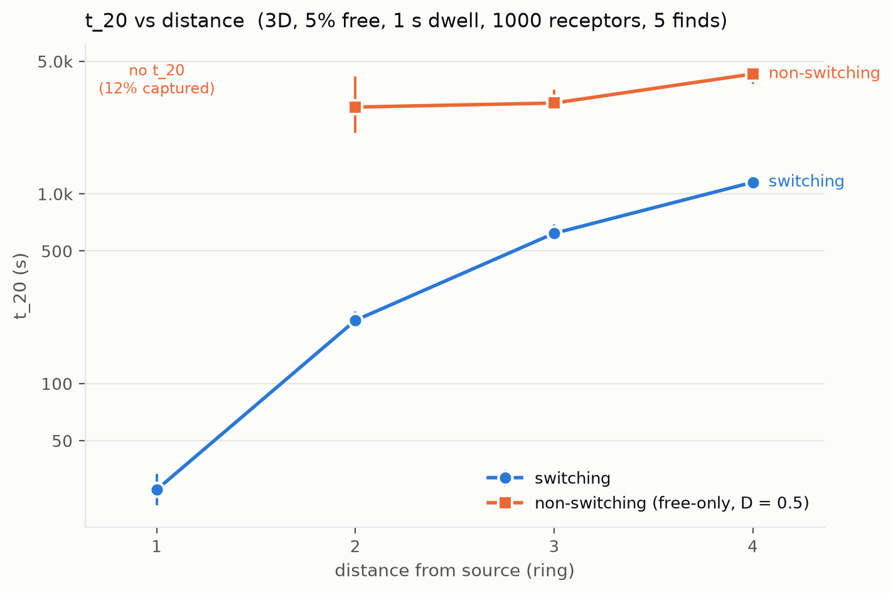

At 5% free, switching wins at every ring, but the margin shrinks with distance: 4.1×,
1.4×, 1.09×, 1.07× at rings 1–4. **Read this axis with the caveat below** — the simulated
domain grows with the target ring, which flatters the reference.

At five finds the margin runs the other way and stays large: 13.3×, 4.9×, 3.7× at rings
2–4, with ring 1 undefined for the reference.

### Receptor density

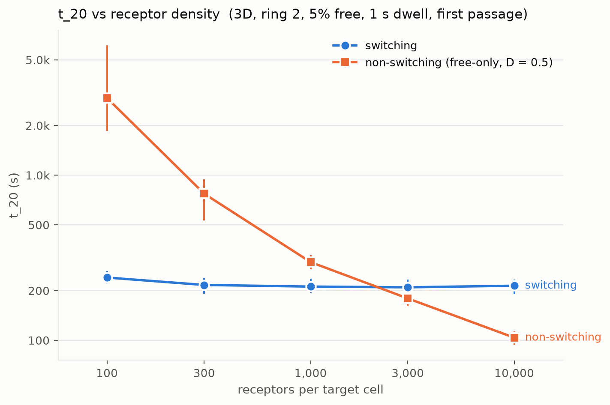

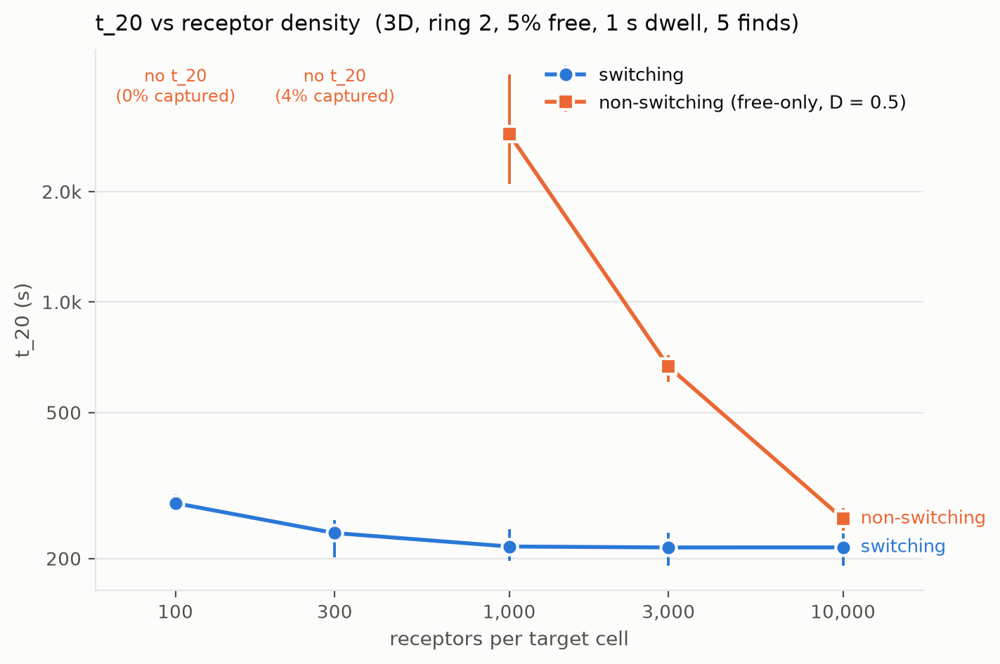

The 1D view of the density grid's 5%-free row: a flat switching line crossed by a
steeply falling reference.

## Caveats

1. **The distance axis has a domain-size confound.** `rings_beyond_target` is 2, so the
   cluster grows with the target ring and a distant target sits in a bigger box with a
   more remote absorbing boundary. The reference's capture fraction consequently *rises*
   with distance (67.8 / 75.8 / 81.0 / 85.2% at rings 1–4) — geometry, not physics. The
   distance comparison is conservative against switching; the other axes are unaffected.
2. **Free capture is still ~5% low.** At a 2 nm capture radius, `distance_fraction`
   0.0625 under-counts free-phase captures by roughly 5% (L93, L94), biasing slightly in
   favour of switching. It was 16% at the old 0.125.
3. **The reference's D is set, not measured.** It is free-only at D = 0.5 by decision
   (L91), not a calibrated D_eff. That is what makes the comparison purely geometric,
   but it is not the same question as "switching vs. an equally mobile effective walker".
4. **`t_max` censors the slow corners.** 20 000 s (100 000 s for the 100 s and 600 s
   dwell points). The 0.1%-free row and the sparse-receptor reference cells are the ones
   that touch it.
5. **t_20 is not conditioned on capture.** This is deliberate — it is why the blank cells
   are informative — but it means t_20 mixes speed with yield and should not be read as
   a mean first-passage time.
6. **3D only.** Multi-find capture is not implemented in 2D, so none of the N > 1 results
   has a 2D counterpart.

## Open questions this raises

- The 10–100 s dwell crossover is bracketed by one decade. One or two intermediate
  dwells would pin it down.
- Density crossover at N = 5 is above 10 000 receptors/cell and was not reached.
- Everything here is at 1 s dwell except the dwell line itself; the dwell × efficiency
  interaction is unexplored, and the efficiency result suggests it is where the effect
  lives.
